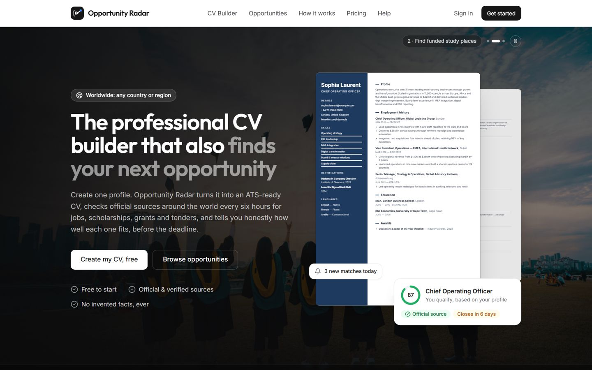
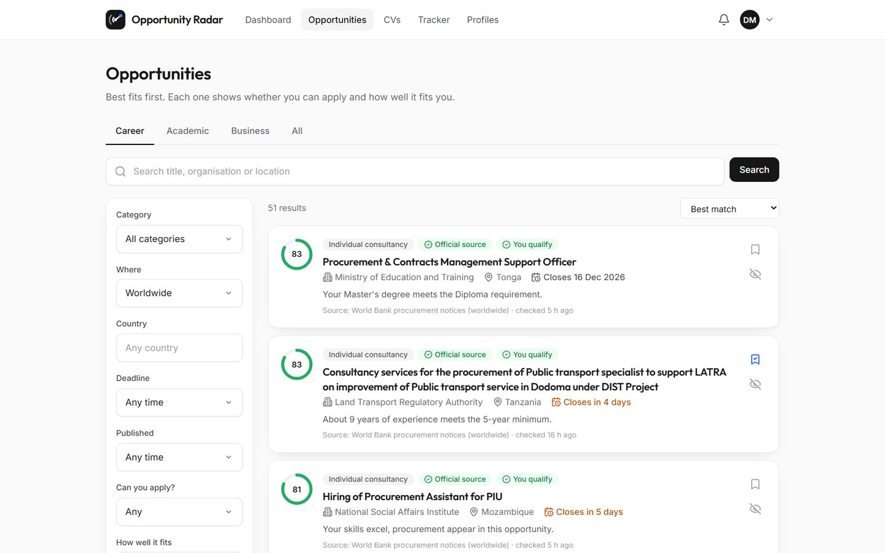
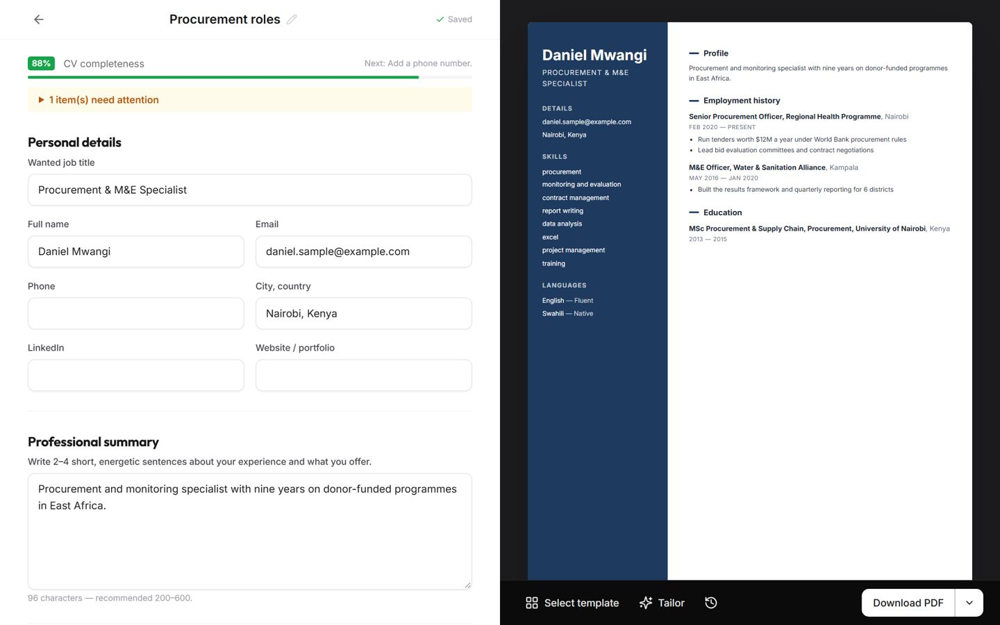
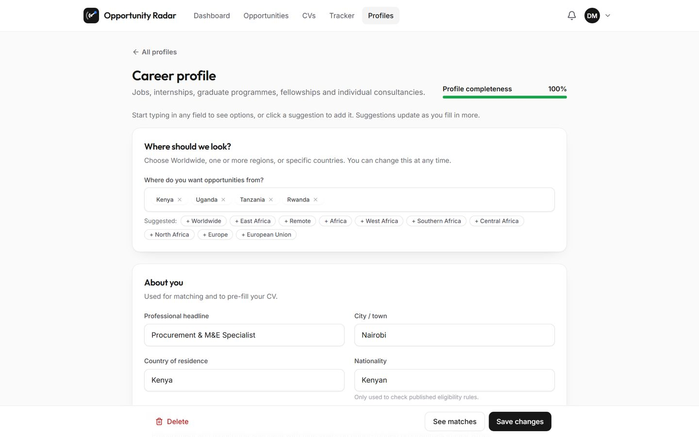
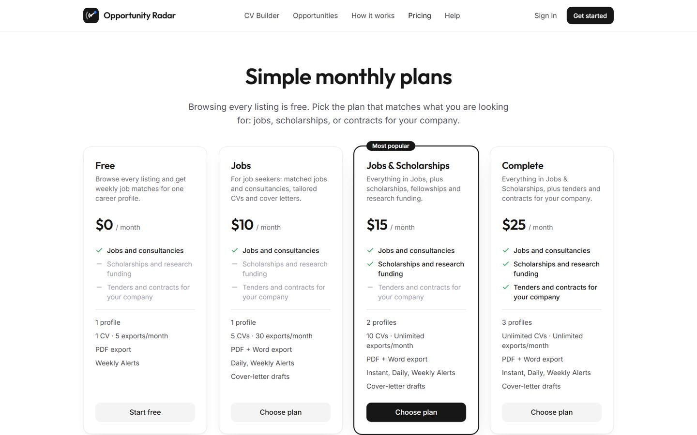

<div align="center">

# Opportunity Radar

**A professional CV builder that also finds your next opportunity, anywhere in the world.**

Build a strong CV, then get jobs, scholarships, grants and tenders matched to you, with a plain answer to two
questions for every one: _can you apply?_ and _how well does it fit?_

[**Live site**](https://opportunity-radar.omodingisaac123.workers.dev) ·
[How it works](https://opportunity-radar.omodingisaac123.workers.dev/how-it-works) ·
[Pricing](https://opportunity-radar.omodingisaac123.workers.dev/pricing) ·
[Documentation](#documentation)




</div>

---

## Why Opportunity Radar

Most job boards show you everything and leave you to work out whether you qualify. Opportunity Radar starts from
your profile and does that work for you:

- **One profile, three kinds of opportunity.** Keep a career, academic and business profile in one account.
  Each is matched only against what suits it: jobs, scholarships, or tenders and contracts.
- **Honest matching.** Every listing says whether you can apply (and why not, when you can't) separately from how
  well it fits. A great fit never hides a requirement you don't meet.
- **Worldwide.** Choose _Worldwide_, regions such as West Africa, Europe or Asia, or specific countries. Listings
  come from official sources around the world and say where they came from.
- **A CV builder that never invents facts.** Live A4 preview, three professional templates, PDF and Word export,
  tailored copies per application and cover-letter drafts, all from what you entered.
- **Guided, not tedious.** Profiles are filled in with type-ahead and one-click suggestions: pick
  “Civil Engineer” and it suggests AutoCAD, Road design and related roles.

## A look inside

<table>
  <tr>
    <td width="50%"><br /><sub><b>Matches</b>: best fits first, each with whether you can apply and why.</sub></td>
    <td width="50%"><br /><sub><b>CV builder</b>: form on the left, live A4 preview on the right.</sub></td>
  </tr>
  <tr>
    <td width="50%"><br /><sub><b>Guided profiles</b>: choose where to look, then fill in with suggestions.</sub></td>
    <td width="50%"><br /><sub><b>Plans</b>: each tier unlocks one more kind of opportunity.</sub></td>
  </tr>
</table>

## Plans

| Plan                    | Price per month | Matches                                      |
| ----------------------- | --------------- | -------------------------------------------- |
| Free                    | $0              | Jobs (one profile, one CV, weekly alerts)    |
| Jobs                    | $10             | Jobs and consultancies                       |
| **Jobs & Scholarships** | **$15**         | Jobs, scholarships and research funding      |
| Complete                | $25             | Everything above, plus tenders and contracts |

Browsing every listing is free on every plan. Plan limits are enforced on the server, not just in the interface.

## How matching works

1. **Can you apply?** Hard requirements are checked first: the deadline, who may apply (countries, regions such as
   the Commonwealth or ECOWAS), required qualifications, years of experience, registration, turnover and
   certificates. Anything unclear becomes “check this”, never a silent rejection.
2. **How well does it fit?** A 0–100 score compares your skills, roles, field of study or services, preferred places
   and other details with the opportunity. When the core fit is missing (a different field, or services the buyer
   doesn't need), the score stays low however well the rest matches.
3. **Explained.** Each match lists the reasons, the gaps, and the facts it used.

The behaviour is checked end to end by a test of fifteen fictional people (five professionals, five scholarship
seekers and five companies) against opportunities with known right answers.

## Built with

| Layer      | Technology                                                                     |
| ---------- | ------------------------------------------------------------------------------ |
| Front end  | React 18, React Router, Tailwind CSS, Vite                                     |
| API        | Hono on Cloudflare Workers (TypeScript, zod validation)                        |
| Data       | Cloudflare D1 (SQLite), Workers KV for private documents                       |
| Scheduling | Cloudflare Cron Triggers: ingestion, alerts, reminders                         |
| Payments   | Pesapal adapter with server-side verification (not yet activated)              |
| Sign-in    | Email and password; Google (OpenID Connect + PKCE), ready to switch on         |
| Testing    | Vitest (unit + integration on real local D1/KV), Playwright (desktop + mobile) |

```
shared/       Types, schemas, CV model, countries, suggestions: used by client and Worker
worker/       Cloudflare Worker: Hono API, scheduled jobs
  domain/     Matching, ingestion connectors, alerts, payments, tailoring
  lib/        Auth and sessions, security, crypto, storage, providers
  routes/     Thin HTTP handlers (validate → domain → respond), admin API
src/          React client: public site, signed-in app, admin console, CV editor
migrations/   D1 SQL migrations, applied in order
tests/        unit, integration, e2e, fixtures (real API samples, 15 personas)
docs/         Product, architecture, data model, sources, security, tests, deployment
```

## Getting started

Requirements: Node.js 20 or newer.

```bash
npm install
cp .dev.vars.example .dev.vars        # local settings; never commit .dev.vars
npm run db:migrate:local               # create the local database
npm run build                          # type-check and build the client
npx wrangler dev --port 8787 --test-scheduled
```

Open <http://127.0.0.1:8787>. An account whose email is listed in `ADMIN_EMAILS` gets the admin console at `/admin`.
Run one scheduler tick (fetch listings, send alerts) with:

```bash
curl "http://127.0.0.1:8787/__scheduled?cron=*/15+*+*+*+*"
```

### Tests and checks

| Command                                 | What it runs                                                       |
| --------------------------------------- | ------------------------------------------------------------------ |
| `npm test`                              | Unit and integration tests (Vitest, real local D1 and KV)          |
| `npm run test:e2e`                      | Browser tests on desktop and mobile (Playwright, needs dev server) |
| `npm run typecheck`                     | TypeScript for client and Worker                                   |
| `npm run lint` / `npm run format:check` | ESLint / Prettier                                                  |

## Deploying

Deployments go through a preview first:

```bash
npm run build
npx wrangler versions upload                                  # prints a preview URL
npm run db:migrate:remote                                     # only when there are new migrations (additive)
# smoke-test the preview, then:
npx wrangler versions deploy <version-id>@100% --yes
```

Secrets are set with `npx wrangler secret put NAME`. See the
[deployment guide](docs/CLOUDFLARE_DEPLOYMENT.md) for the full list, and the
[release report](docs/RELEASE_REPORT.md) for switching on Google sign-in.

## Status

| Area                 | Status                                                        |
| -------------------- | ------------------------------------------------------------- |
| CV builder, matching | Live                                                          |
| Worldwide listings   | Live: World Bank, Grants.gov, remote jobs, plus admin-curated |
| Plans and limits     | Live; online payments not yet activated                       |
| Google sign-in       | Built and tested; switches on when Google keys are added      |
| Email alerts         | In-app now; email delivery once a provider is configured      |
| AI assistance        | Planned; the matching and CV tools work without it today      |

Known gaps are listed honestly in [known limitations](docs/KNOWN_LIMITATIONS.md).

## Documentation

[Product spec](docs/PRODUCT_SPEC.md) · [Architecture](docs/ARCHITECTURE.md) · [Data model](docs/DATA_MODEL.md) ·
[Opportunity sources](docs/OPPORTUNITY_SOURCES.md) · [Matching and AI](docs/AI_AND_MATCHING.md) ·
[Security and privacy](docs/SECURITY_AND_PRIVACY.md) · [Test plan](docs/TEST_PLAN.md) ·
[Deployment](docs/CLOUDFLARE_DEPLOYMENT.md) · [Known limitations](docs/KNOWN_LIMITATIONS.md) ·
[Release report](docs/RELEASE_REPORT.md) · [Handoff notes](docs/CODEX_HANDOFF.md)

---

<div align="center"><sub>Opportunity Radar never guarantees selection. Always read the official notice before you apply.</sub></div>
